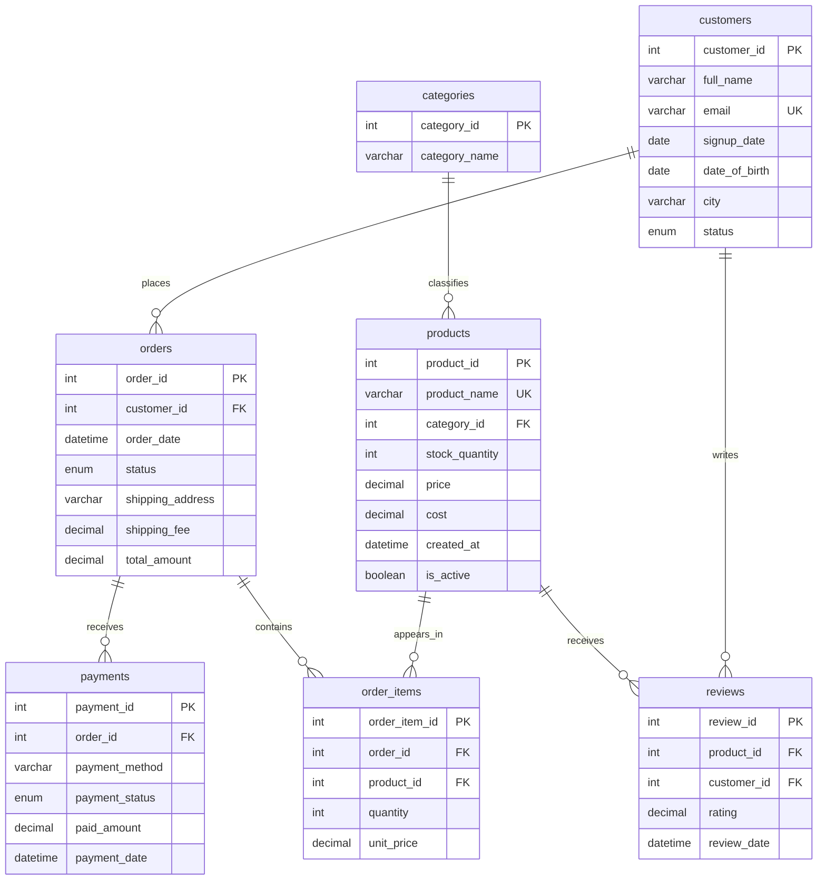

# Database design

This ERD reflects the canonical SQL schema in this repository. It is reconstructed
from the technical coursework files, with no student identifiers or group-report metadata.

## Relationships and stored values

Orders and products are many-to-many through `order_items`. Payments are separate
from order status; the schema allows multiple payments for one order, although the
seed generator creates one. Reviews reference a customer and product, not an order.
The generator only creates reviews for purchased customer/product pairs, but that
rule is not enforced by a database constraint.

`order_items.unit_price` preserves the sale price. `products.cost` is current product
cost, so calculated historical profit is a classroom estimate, not a cost ledger.
`orders.total_amount` stores item subtotal plus shipping. Two insert triggers reduce
stock and recalculate that total; one delete trigger restores stock and recalculates it.

## Coursework limitations

This retains the original schema and three triggers. There is no order-item update
trigger, stock-availability guard, cancellation/refund inventory reversal or payment
reconciliation trigger. Quantities/prices/rating bounds are not CHECK constraints;
stock can become negative. Do not use this design directly for production inventory.

The initial generated stock values are snapshot/demo values. Importing the historical
seed before installing triggers avoids subtracting all historical sales from them.
Fresh inserts after trigger installation demonstrate inventory deltas.
